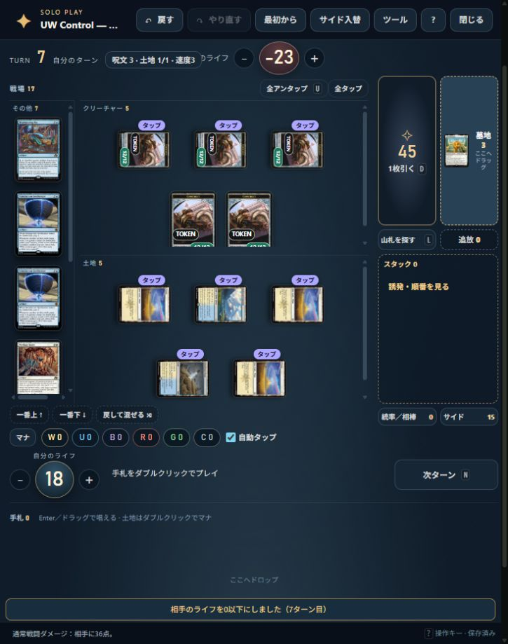
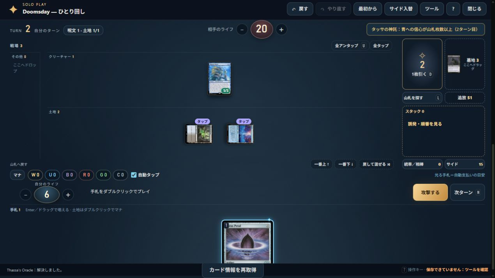
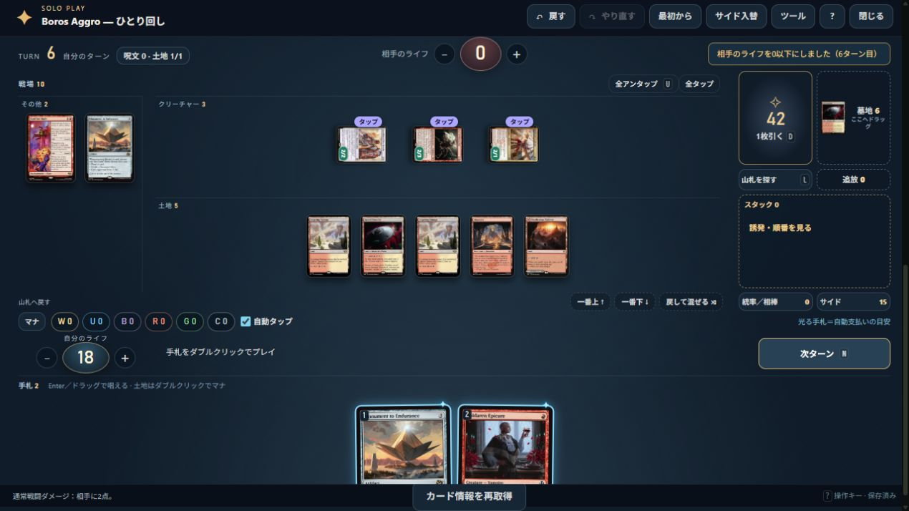

# 公開版・3フォーマット各上位10種類のひとり回し検証（2026-10-21）

[公開版](https://mtg-token-finder-nobinko.nobinko.chatgpt.site/)で、Standard・Legacy・Pioneerの各10種類、**メイン30ゲーム＋サイド後30ゲームの計60ゲーム**を決着まで操作した。途中で見つけた不具合は修正して公開し、該当ゲームを再開またはやり直して確認した。最後のアプリ処理の変更は `ca615406f7c6f43369df3eaaf734e4dcc812ecbc`、検証時の画面の資産版は `20261021-public30n`（v31）。その後の検証資料のみの公開でも同じ資産版を使用する。

## 対象と確認方法

- 順位は2026-10-20取得のMTGTop8の掲載中集計。同率は出典の掲載順。検証用にこの30種類を固定しただけで、アプリの大会一覧・検索結果・将来の環境を固定するものではない。
- 各分類から実在リストを1件選択。Standardは公開版の環境検索から取得したリスト、Legacy/Pioneerは取得した実リストを公開版の貼り付け入口から開始。出典・元のメイン/サイド枚数・交換内容を[機械可読記録](evidence/public-top30-2026-10-21.json)へ保存した。LegacyのDimir TempoとLandsは61枚、Borosはサイド14枚で、出典の構成を保っている。
- 自然な初手でのゲームと、コンボの分岐を確実に通すための指定初手を区別。指定初手は公開画面の「山札を探す」「山札へ戻す」で7枚を用意し、その後の土地プレイ・マナ・ターン進行・誘発は通常の操作を使用。内部状態やマナの注入はしていない。
- サイド後は画面で実際に入れ替え、少なくとも1種類の投入カードを使用して決着した。投入した15枚全てを使用したという意味ではない。下表は使用を確認できた投入カードだけを示す。
- 相手盤面を置かないひとり回し。対象、モード、捨てるカード、順序、仮想相手の条件などは利用者が選択する。相手の手札・ブロック・優先権を含む対戦AIの検証ではない。
- ターン数は確認した経路の実績。サイドカードや追加能力を試すため攻撃を待ったゲームもあり、速度・勝率の評価には使わない。
- 「完走」はそのゲームで通った経路の確認であり、30リストの全カード・全分岐の完全対応を意味しない。未使用の分岐は下の補足で明示する。

自然初手 39ゲーム、指定初手 21ゲーム。全60件は公開版の画面操作であり、ローカルの回帰試験とは別に実施した。

## Standard

[順位の出典](https://mtgtop8.com/format?f=ST)：母数471件、取得 2026-10-20T12:54:46.660Z。

| 順位・実リスト | メイン | サイド後 | 初手（メイン / 後） | 使用した投入カード |
|---|---:|---:|---|---|
| 1. [Dimir Aggro](https://mtgtop8.com/event?e=92549&d=903046&f=ST) | 6T | 10T | 自然 / 自然 | Duress |
| 2. [UW Control](https://mtgtop8.com/event?e=92555&d=903092&f=ST) | 7T | 8T | 自然 / 自然 | Voice of Victory |
| 3. [Mono Green Aggro](https://mtgtop8.com/event?e=92522&d=902836&f=ST) | 6T | 7T | 自然 / 自然 | Meltstrider's Resolve |
| 4. [Izzet Control](https://mtgtop8.com/event?e=92387&d=901732&f=ST) | 7T | 12T | 自然 / 自然 | Colorstorm Stallion |
| 5. [Orzhov Aggro](https://mtgtop8.com/event?e=92496&d=902650&f=ST) | 8T | 7T | 自然 / 自然 | Strategic Betrayal |
| 6. [Dimir Control](https://mtgtop8.com/event?e=92523&d=902848&f=ST) | 9T | 15T | 自然 / 自然 | Doomsday Excruciator |
| 7. [Jund Aggro](https://mtgtop8.com/event?e=92496&d=902646&f=ST) | 7T | 7T | 自然 / 自然 | Ral Zarek, Guest Lecturer |
| 8. [Reanimator](https://mtgtop8.com/event?e=92495&d=902639&f=ST) | 13T | 8T | 自然 / 自然 | Null Summoner、Preacher of the Schism |
| 9. [Boros Aggro](https://mtgtop8.com/event?e=92555&d=903095&f=ST) | 7T | 9T | 自然 / 自然 | Boros Charm |
| 10. [4/5C Control](https://mtgtop8.com/event?e=92546&d=903032&f=ST) | 8T | 10T | 自然 / 自然 | Get Lost、Flashfreeze |

確認した主な経路：

1. **Dimir Aggro**：Dream Beavers、Spyglass Siren、Kaito、Enduring Curiosityの展開と戦闘ドロー。サイド後はDuressを使用。
2. **UW Control**：SynthesizerとRepurposing Bayのアーティファクト連鎖、12/12構築物、動員、Snareの最高速度、Net/Relicの離脱、Quipuの変身。Voiceで決着。
3. **Mono Green Aggro**：Cultivator、Fabled Passage、追加土地、Nursery。Meltstriderの格闘では仮想相手のパワー2を選択。
4. **Izzet Control**：Hearth Elemental、Sunderflock、Colorstorm Stallionの連続呪文強化。
5. **Orzhov Aggro**：Clericのライフ喪失誘発、Strategic Betrayal。入れ替えたDuressの使用は記録していない。
6. **Dimir Control**：CryomancerとDoomsday Excruciator。サイド後は黒6点を支払い、山札6枚への処理から攻撃で決着。
7. **Jund Aggro**：Lively Dirgeの両モード、Biotech Specialist、Freebooter、Ralの諜報と蘇生、Landerの生け贄と8点。
8. **Reanimator**：Cryomancerのドローと蘇生。メインは追加ドローでの山札切れをUndoし攻撃で決着。サイド後はNull Summonerの追加コストとPreacher。
9. **Boros Aggro**：飛行クリーチャーと動員。サイド後はBoros Charmの4点を使用。
10. **4/5C Control**：Lightning Helixのフラッシュバック、Great Hallのクリーチャー化、Ancient Vendetta、Together as One、Jeskai Revelation。Get LostとFlashfreeze。

## Legacy

[順位の出典](https://mtgtop8.com/format?f=LE)：母数517件、取得 2026-10-20T12:54:47.664Z。

| 順位・実リスト | メイン | サイド後 | 初手（メイン / 後） | 使用した投入カード |
|---|---:|---:|---|---|
| 1. [Dimir Tempo](https://mtgtop8.com/event?e=92342&d=901441&f=LE) | 7T | 8T | 自然 / 自然 | Barrowgoyf、Nihil Spellbomb |
| 2. [Boros Aggro](https://mtgtop8.com/event?e=92413&d=901956&f=LE) | 6T | 8T | 自然 / 自然 | Containment Priest |
| 3. [UWx Control](https://mtgtop8.com/event?e=92448&d=902281&f=LE) | 7T | 13T | 自然 / 自然 | Lavinia, Azorius Renegade |
| 4. [Show and Tell](https://mtgtop8.com/event?e=92415&d=901977&f=LE) | 4T | 4T | 指定 / 指定 | Hexing Squelcher |
| 5. [UR Tempo](https://mtgtop8.com/event?e=92136&d=899795&f=LE) | 13T | 8T | 自然 / 自然 | Price of Progress |
| 6. [Lands](https://mtgtop8.com/event?e=92453&d=902325&f=LE) | 3T | 6T | 指定 / 指定 | Choke |
| 7. [Hogaak](https://mtgtop8.com/event?e=92449&d=902301&f=LE) | 8T | 9T | 自然 / 自然 | Orcish Bowmasters |
| 8. [Eldrazi Aggro](https://mtgtop8.com/event?e=92448&d=902288&f=LE) | 4T | 6T | 自然 / 自然 | Disruptor Flute |
| 9. [Cloudpost / Tron Ramp](https://mtgtop8.com/event?e=92501&d=902685&f=LE) | 8T | 9T | 指定 / 指定 | Barrowgoyf |
| 10. [Doomsday](https://mtgtop8.com/event?e=92449&d=902298&f=LE) | 2T | 2T | 指定 / 指定 | Duress |

確認した主な経路：

1. **Dimir Tempo**：Brainstorm/Ponder、Bowmastersの軍団、Murktideの探査、Tamiyoの変身。サイド後はBarrowgoyfとSpellbomb。
2. **Boros Aggro**：Ajaniの猫と死亡時変身、Guide/Raptorのエネルギー、Ocelotの都市の承認と猫6体。サイド後はContainment Priest。
3. **UWx Control**：Murktide、Tamiyo、Brainstorm/Ponder。サイド後はLaviniaを展開して決着。
4. **Show and Tell**：メインはShow and Tell→Omniscience→Emrakulの追加ターン。サイド後はSneak AttackからAtraxaの上10枚選択とEmrakul、速攻24点。終了時のSneak生け贄は決着後になるためこのゲームでは未確認。
5. **UR Tempo**：DRC、Monk、Delver、Murktide。サイド後はPrice of Progressに仮想相手の非基本土地2枚を指定。
6. **Lands**：Thespian’s StageでDark Depthsをコピー、カウンターなしのMarit Lage生成と20点。サイド後はLoamの土地回収・発掘3とChoke。
7. **Hogaak**：Hogaakの召集・探査と8/8での攻撃、サイド後はBowmasters。初回の支払い選択後、自動提案2体＋5枚は別途公開版で再確認。
8. **Eldrazi Aggro**：Tomb/Temple/Cavernのマナ、Fleshraker、Thought-Knot Seer、Kozilek’s CommandのX=0。サイド後はFluteでWastelandを指定。
9. **Cloudpost / Tron Ramp**：出典の大分類に属するUB Tronの実リスト。Karn−2でサイドのLatticeを取得し、＋1で6/6化。サイド後はRing、Trainerの新生と2回のETB、Riftの超過、Lórienの3枚ドロー。
10. **Doomsday**：Doomsdayで5枚を選び並べ、Street Wraith、Petal、Thassa’s Oracleで2ターン目に特殊勝利。サイド後はDuressを実際に唱えて同じ勝ち筋へ。

## Pioneer

[順位の出典](https://mtgtop8.com/format?f=PI)：母数118件、取得 2026-10-20T12:54:51.657Z。

| 順位・実リスト | メイン | サイド後 | 初手（メイン / 後） | 使用した投入カード |
|---|---:|---:|---|---|
| 1. [UR Aggro](https://mtgtop8.com/event?e=92465&d=902416&f=PI) | 6T | 7T | 自然 / 指定 | Quantum Riddler |
| 2. [Jund](https://mtgtop8.com/event?e=92465&d=902418&f=PI) | 5T | 15T | 指定 / 自然 | Thoughtseize |
| 3. [The Rock (Golgari Control)](https://mtgtop8.com/event?e=92465&d=902407&f=PI) | 7T | 7T | 自然 / 自然 | Duress、Professor Dellian Fel |
| 4. [Red Deck Wins](https://mtgtop8.com/event?e=92467&d=902430&f=PI) | 6T | 5T | 自然 / 自然 | Sunspine Lynx |
| 5. [Devotion to Green](https://mtgtop8.com/event?e=92228&d=900632&f=PI) | 5T | 8T | 指定 / 指定 | Cityscape Leveler |
| 6. [Izzet Control](https://mtgtop8.com/event?e=92227&d=900622&f=PI) | 7T | 8T | 自然 / 指定 | Ral, Crackling Wit、Stormwing Entity |
| 7. [Greasefang Parhelion](https://mtgtop8.com/event?e=92467&d=902429&f=PI) | 4T | 5T | 指定 / 指定 | Duress |
| 8. [Dimir Aggro](https://mtgtop8.com/event?e=92475&d=902471&f=PI) | 7T | 6T | 指定 / 指定 | Duress、Enduring Curiosity |
| 9. [Boros Aggro](https://mtgtop8.com/event?e=92139&d=899828&f=PI) | 6T | 6T | 指定 / 指定 | Monument to Endurance |
| 10. [Azorius Tempo / Spirit Aggro](https://mtgtop8.com/event?e=92464&d=902399&f=PI) | 7T | 10T | 指定 / 指定 | Elesh Norn, Mother of Machines、Narset, Parter of Veils |

確認した主な経路：

1. **UR Aggro**：果敢、Academic Disputeの履修からサイドのAccumulate Wisdom。サイド後はQuantumのワープ、Improvised Actの準備済み呪文。終了時追放から通常コストでの唱え直しは別途公開版で再確認。
2. **Jund**：メインはYgra＋Cauldron Familiar2体の食物ループを画面から15回繰り返して勝利。サイド後はThoughtseizeを待ち、Lively Dirge、Ovenの生け贄、Mayhem Devil誘発、Ygra強化で決着。
3. **The Rock (Golgari Control)**：Graveyard Trespasserの昼夜、Unholy Annexのドローとライフ。サイド後はDuressとDellianを展開。Roomの解錠とDellianの起動はこのゲームでは未使用。
4. **Red Deck Wins**：Kumanoの章・変身と果敢。サイド後はSunspine Lynxに仮想相手の非基本土地2枚を指定。
5. **Devotion to Green**：Nykthosの起動コスト2、緑信心、Kiora−1のアンタップから再起動、Vibranceの土地探索とドロー。サイド後は信心9のマナからCityscape Levelerを唱えて攻撃。
6. **Izzet Control**：Fading Hopeの仮想対象はマナ総量2、Get Outの仮想呪文。サイド後はRal＋1でOtter、−3で3枚引き2枚捨て、Stormwingの軽減・占術・果敢。
7. **Greasefang Parhelion**：SpiritでParhelionを捨て、戦闘開始にGreasefangで蘇生、搭乗4、天使2体、終了時に手札へ戻るまで。サイド後はDuressも使用。
8. **Dimir Aggro**：HackerとKaitoの忍術、Kaitoの初期忠誠度・クリーチャー化・諜報とドロー。保存→再読込→Undo/Redo。サイド後はDuress、Curiosity、Mutavaultの3/3忍者化とターン終了時の解除。
9. **Boros Aggro**：GuardianとCool but Rudeの捨てる処理、Fiery Temperのマッドネス。サイド後はMonumentの各モード制限、昂揚FOMOの追加戦闘を画面のボタンから開始し2回目の攻撃で勝利。
10. **Azorius Tempo / Spirit Aggro**：Momoの軽減、QuantumのワープとEssence Fluxでの明滅、Aangの気の技から唱え直し。サイド後はNorn下のETB2回、Skycoachの準備済みAll Aboard、Quantumで手札5→7。Narsetも唱えたがClarion下で忠誠度能力は未使用。

## 公開操作で見つけて直した箇所

- カード情報取得の共有・再試行、公開Workerでのタイマー分離、既知のカード情報を使った即時開始、リスト貼り付けからの直接開始。外部照合待ちでひとり回しを開始できない経路を解消。
- タップイン条件、追加コスト、生け贄と誘発の接続、Clue/Scionの生成、UWのアーティファクト連鎖、Ralの忠誠度と土地能力など、実リストで止まった処理を接続。
- Hogaakの支払い候補を自動選択。Karn/Latticeの継続効果、The One Ringの保護・重荷・ドロー・アップキープ、Trainerの新生、Cyclonic Riftの超過、Lórien Revealedのドロー、Nykthosの信心マナを実装。
- Kaitoが忍術で戦場に出た直後、忠誠度未設定で墓地へ落ちる問題を修正。自分のターンのクリーチャー化と忠誠度を保つ。[公式リリースノート](https://magic.wizards.com/en/news/feature/duskmourn-house-of-horror-release-notes)に沿って、クリーチャー中はプレインズウォーカー型を失う。
- Mutavaultなどの土地クリーチャー能力を操作候補に追加。自分自身をタップせず払える場合のマナ選択、部族修整、ターン終了時の解除を修正。公開版ではMutavaultの2/2→忍者紋章込み3/3と解除を確認。他の追加土地能力の細かな分岐は回帰試験で確認した。
- FOMOで追加戦闘を得ても攻撃ボタンが消える問題を修正。「追加戦闘（残り1回）」から次の戦闘へ進み、実際に2回目の戦闘で勝利。
- 多数のデッキ保存でlocalStorageの容量が埋まり保存に失敗する問題を修正。ゲームとUndo/RedoをIndexedDBに保存し、旧保存も読み込む。実際に容量エラーが起きたブラウザーで保存→再読込→継続→Undo/Redoを確認。保存のために操作履歴や別デッキを削除していない。

## 記録の補足と範囲

- 修正前の誤った土地進入を含む7ゲームと、Kaitoが即座に墓地へ落ちたゲームは成功件数から除外し、修正版のゲームで置き換えた。
- Standard Reanimatorのサイド後は操作ツールのタイムアウトで序盤のイベント記録と開始時刻が欠ける。公開画面で再開・決着を確認したが、完全な逐次ログとは扱わない。終了時刻・決着状態・投入カードの使用記録は残る。
- Quantumの再唱えで、領域パネルの裏にある操作を押しても唱えられていない場面があったため成功扱いせず、追放カードの専用ボタンから再試験した。URはワープ→終了時追放→5ターン目の通常コスト、Azoriusは勝利前にUndoして気の技の軽減コストでの唱え直し→再攻撃を確認。
- Norn下のQuantum明滅は、準備済みAll Aboardを支払い、ETBが2回誘発して手札5枚から7枚へ増えるところまで確認。単にそのカードを戦場に置けたことをコンボ確認とは数えていない。
- Lórienの島サイクリングや、今回公開画面で起動しなかった土地能力などは単体回帰試験の証拠であり、公開版の60ゲームで実操作した証拠とは区別する。
- 最終アプリコードの `node --test` は **639件成功・失敗0**。公開用ビルドと `scripts/verify-hosted.mjs --release` も実施。途中の各ゲームはその時点の修正版で完了し、60ゲーム全てを最終v31でもう一度やり直したものではない。

## 保存した証跡

- [60ゲームの記録・順位のスナップショット・サイド交換・指定初手・主な操作](evidence/public-top30-2026-10-21.json)
- 元リストとカード情報：`test/fixtures/goldfish-public-top30.json`。フィクスチャのSHA-256を記録と照合した。
- 全60枚の決着画面はローカルの `.cache/public-top30-{format}-{rank}-{main|post}.png`。それぞれのSHA-256とサイズを記録に保存。代表3枚は以下に同梱。
- 前回の各1種類・6ゲームの記録は[2026-10-20の検証](public-solo-verification-2026-10-20.md)。今回の60ゲームとは別。

### Standard：UWの構築物連鎖

### Legacy：Doomsdayのサイド後・神託者勝利

### Pioneer：FOMOの追加戦闘で決着

